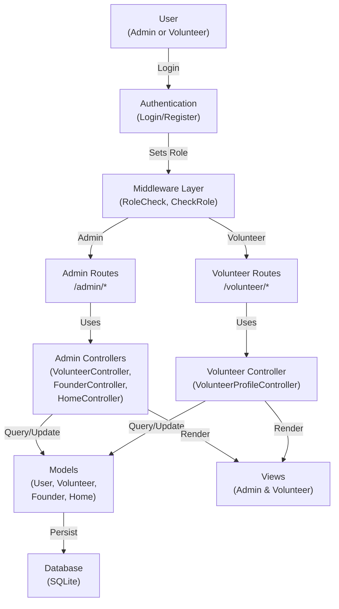

# Design: Role-Based Volunteer Management & Refactoring

## Overview

This design document specifies the technical architecture for implementing role-based access control, soft-delete functionality, comprehensive CRUD operations, data seeding, and authentication design updates for the TahananHeritage Laravel application. The implementation establishes clear separation between Admin and Volunteer user roles, introduces soft-delete support across all models, provides realistic seeded data, and maintains secure data relationships.

The architecture follows Laravel 13 best practices with Eloquent models, form requests for validation, middleware for authorization, and organized view structure. All components are designed for maintainability, testability, and compliance with the grading rubric's 100-point requirements.

---

## Architecture

### Overall System Architecture



### Middleware Architecture for Role-Based Access Control

Two middleware classes enforce authorization:

1. **CheckRole Middleware** (`app/Http/Middleware/CheckRole.php`)
   - Verifies authenticated user exists
   - Checks `user.role` attribute
   - Allows/redirects based on role and route

2. **IsAdmin Middleware** (`app/Http/Middleware/IsAdmin.php`)
   - Protects admin-only routes
   - Redirects non-admins to volunteer dashboard
   - Displays error notification

**Flow:**
```
User Request → CheckRole Middleware → IsAdmin Middleware → Controller Action → Response
                      ↓ (if not authenticated)
                   Redirect to Login
                      ↓ (if Volunteer accessing Admin route)
                   Redirect to Volunteer Dashboard + Error Flash
```

---

## Components and Interfaces

### 1. Models & Eloquent Relationships

#### **User Model** (`app/Models/User.php`)

```php
class User extends Authenticatable
{
    use HasFactory, Notifiable, SoftDeletes;

    protected $fillable = [
        'name',
        'email',
        'password',
        'role', // 'admin' or 'volunteer'
    ];

    protected $hidden = [
        'password',
        'remember_token',
    ];

    protected $casts = [
        'email_verified_at' => 'datetime',
        'password' => 'hashed',
        'role' => 'string',
    ];

    // Scopes
    public function scopeAdmins(Builder $query): Builder
    {
        return $query->where('role', 'admin');
    }

    public function scopeVolunteers(Builder $query): Builder
    {
        return $query->where('role', 'volunteer');
    }

    // Relationship: A user may have one volunteer profile
    public function volunteer(): HasOne
    {
        return $this->hasOne(Volunteer::class);
    }

    // Helper method
    public function isAdmin(): bool
    {
        return $this->role === 'admin';
    }

    public function isVolunteer(): bool
    {
        return $this->role === 'volunteer';
    }
}
```

**Key Features:**
- `role` enum (admin/volunteer) determines access level
- `SoftDeletes` trait enables soft-delete operations
- Helper methods `isAdmin()` and `isVolunteer()` for role checks
- Scopes for filtering users by role
- Relationship to Volunteer model

---

#### **Volunteer Model** (`app/Models/Volunteer.php`)

```php
class Volunteer extends Model
{
    use HasFactory, SoftDeletes;

    protected $fillable = [
        'first_name',
        'last_name',
        'email',
        'phone_number',
        'user_id', // Optional: link to User if needed
    ];

    protected $casts = [
        'created_at' => 'datetime',
        'updated_at' => 'datetime',
        'deleted_at' => 'datetime',
    ];

    // Relationship: Volunteer belongs to User (optional)
    public function user(): BelongsTo
    {
        return $this->belongsTo(User::class);
    }

    // Accessor for full name
    public function getFullNameAttribute(): string
    {
        return "{$this->first_name} {$this->last_name}";
    }
}
```

**Key Features:**
- `SoftDeletes` for soft-delete support
- `fillable` array lists assignable properties
- Relationship to User model
- Full name accessor for convenience

---

#### **Founder Model** (`app/Models/Founder.php`)

```php
class Founder extends Model
{
    use HasFactory, SoftDeletes;

    protected $fillable = [
        'first_name',
        'last_name',
        'position',
        'img_url',
    ];

    protected $casts = [
        'created_at' => 'datetime',
        'updated_at' => 'datetime',
        'deleted_at' => 'datetime',
    ];

    // Accessor for full name
    public function getFullNameAttribute(): string
    {
        return "{$this->first_name} {$this->last_name}";
    }
}
```

**Key Features:**
- `SoftDeletes` for soft-delete support
- `img_url` for founder portrait/image
- Full name accessor

---

#### **Home Model** (`app/Models/Home.php`)

```php
class Home extends Model
{
    use HasFactory, SoftDeletes;

    protected $fillable = [
        'house_name',
        'location',
        'img_url',
    ];

    protected $casts = [
        'created_at' => 'datetime',
        'updated_at' => 'datetime',
        'deleted_at' => 'datetime',
    ];
}
```

**Key Features:**
- `SoftDeletes` for soft-delete support
- Heritage home properties

---

### 2. Controllers

#### **VolunteerController** (`app/Http/Controllers/Admin/VolunteerController.php`)

Handles admin management of volunteers and volunteer profile management.

```php
namespace App\Http\Controllers\Admin;

class VolunteerController extends Controller
{
    // Admin: List all volunteers (excluding soft-deleted by default)
    public function index(): View
    {
        $volunteers = Volunteer::paginate(15);
        return view('admin.volunteers.index', compact('volunteers'));
    }

    // Admin: Show specific volunteer details
    public function show(Volunteer $volunteer): View
    {
        return view('admin.volunteers.show', compact('volunteer'));
    }

    // Admin: Display create volunteer form
    public function create(): View
    {
        return view('admin.volunteers.create');
    }

    // Admin: Store new volunteer
    public function store(StoreVolunteerRequest $request): RedirectResponse
    {
        Volunteer::create($request->validated());
        return redirect()->route('admin.volunteers.index')
            ->with('success', 'Volunteer created successfully.');
    }

    // Admin: Display edit volunteer form
    public function edit(Volunteer $volunteer): View
    {
        return view('admin.volunteers.edit', compact('volunteer'));
    }

    // Admin: Update volunteer
    public function update(UpdateVolunteerRequest $request, Volunteer $volunteer): RedirectResponse
    {
        $volunteer->update($request->validated());
        return redirect()->route('admin.volunteers.index')
            ->with('success', 'Volunteer updated successfully.');
    }

    // Admin: Soft-delete volunteer
    public function destroy(Volunteer $volunteer): RedirectResponse
    {
        $volunteer->delete();
        return redirect()->route('admin.volunteers.index')
            ->with('success', 'Volunteer deleted successfully.');
    }

    // Admin: Restore soft-deleted volunteer
    public function restore(int $id): RedirectResponse
    {
        $volunteer = Volunteer::onlyTrashed()->findOrFail($id);
        $volunteer->restore();
        return redirect()->route('admin.volunteers.index')
            ->with('success', 'Volunteer restored successfully.');
    }

    // Admin: Permanently delete volunteer
    public function forceDelete(int $id): RedirectResponse
    {
        $volunteer = Volunteer::onlyTrashed()->findOrFail($id);
        $volunteer->forceDelete();
        return redirect()->route('admin.volunteers.index')
            ->with('success', 'Volunteer permanently deleted.');
    }

    // Admin: Show deleted volunteers
    public function showDeleted(): View
    {
        $volunteers = Volunteer::onlyTrashed()->paginate(15);
        return view('admin.volunteers.deleted', compact('volunteers'));
    }
}
```

**Key Methods:**
- `index()`: Paginated list of active volunteers
- `show()`: View individual volunteer
- `create()`: Display creation form
- `store()`: Validate and create volunteer
- `edit()`: Display edit form
- `update()`: Validate and update volunteer
- `destroy()`: Soft-delete volunteer
- `restore()`: Restore soft-deleted volunteer
- `forceDelete()`: Permanently delete volunteer
- `showDeleted()`: Display soft-deleted volunteers

---

#### **FounderController** (`app/Http/Controllers/Admin/FounderController.php`)

Similar structure to VolunteerController:

```php
namespace App\Http\Controllers\Admin;

class FounderController extends Controller
{
    public function index(): View
    {
        $founders = Founder::paginate(15);
        return view('admin.founders.index', compact('founders'));
    }

    public function show(Founder $founder): View
    {
        return view('admin.founders.show', compact('founder'));
    }

    public function create(): View
    {
        return view('admin.founders.create');
    }

    public function store(StoreFounderRequest $request): RedirectResponse
    {
        Founder::create($request->validated());
        return redirect()->route('admin.founders.index')
            ->with('success', 'Founder created successfully.');
    }

    public function edit(Founder $founder): View
    {
        return view('admin.founders.edit', compact('founder'));
    }

    public function update(UpdateFounderRequest $request, Founder $founder): RedirectResponse
    {
        $founder->update($request->validated());
        return redirect()->route('admin.founders.index')
            ->with('success', 'Founder updated successfully.');
    }

    public function destroy(Founder $founder): RedirectResponse
    {
        $founder->delete();
        return redirect()->route('admin.founders.index')
            ->with('success', 'Founder deleted successfully.');
    }

    public function restore(int $id): RedirectResponse
    {
        $founder = Founder::onlyTrashed()->findOrFail($id);
        $founder->restore();
        return redirect()->route('admin.founders.index')
            ->with('success', 'Founder restored successfully.');
    }

    public function forceDelete(int $id): RedirectResponse
    {
        $founder = Founder::onlyTrashed()->findOrFail($id);
        $founder->forceDelete();
        return redirect()->route('admin.founders.index')
            ->with('success', 'Founder permanently deleted.');
    }

    public function showDeleted(): View
    {
        $founders = Founder::onlyTrashed()->paginate(15);
        return view('admin.founders.deleted', compact('founders'));
    }
}
```

---

#### **HomeController** (`app/Http/Controllers/Admin/HomeController.php`)

```php
namespace App\Http\Controllers\Admin;

class HomeController extends Controller
{
    public function index(): View
    {
        $heritageHomes = Home::paginate(15);
        return view('admin.homes.index', compact('heritageHomes'));
    }

    public function show(Home $home): View
    {
        return view('admin.homes.show', compact('home'));
    }

    public function create(): View
    {
        return view('admin.homes.create');
    }

    public function store(StoreHomeRequest $request): RedirectResponse
    {
        Home::create($request->validated());
        return redirect()->route('admin.homes.index')
            ->with('success', 'Heritage home created successfully.');
    }

    public function edit(Home $home): View
    {
        return view('admin.homes.edit', compact('home'));
    }

    public function update(UpdateHomeRequest $request, Home $home): RedirectResponse
    {
        $home->update($request->validated());
        return redirect()->route('admin.homes.index')
            ->with('success', 'Heritage home updated successfully.');
    }

    public function destroy(Home $home): RedirectResponse
    {
        $home->delete();
        return redirect()->route('admin.homes.index')
            ->with('success', 'Heritage home deleted successfully.');
    }

    public function restore(int $id): RedirectResponse
    {
        $home = Home::onlyTrashed()->findOrFail($id);
        $home->restore();
        return redirect()->route('admin.homes.index')
            ->with('success', 'Heritage home restored successfully.');
    }

    public function forceDelete(int $id): RedirectResponse
    {
        $home = Home::onlyTrashed()->findOrFail($id);
        $home->forceDelete();
        return redirect()->route('admin.homes.index')
            ->with('success', 'Heritage home permanently deleted.');
    }

    public function showDeleted(): View
    {
        $heritageHomes = Home::onlyTrashed()->paginate(15);
        return view('admin.homes.deleted', compact('heritageHomes'));
    }
}
```

---

#### **VolunteerProfileController** (`app/Http/Controllers/Volunteer/VolunteerProfileController.php`)

Handles volunteer's own profile management.

```php
namespace App\Http\Controllers\Volunteer;

class VolunteerProfileController extends Controller
{
    // Volunteer: Show their own profile
    public function show(): View
    {
        $volunteer = auth()->user()->volunteer;
        return view('volunteer.profile.show', compact('volunteer'));
    }

    // Volunteer: Display edit form for their own profile
    public function edit(): View
    {
        $volunteer = auth()->user()->volunteer;
        return view('volunteer.profile.edit', compact('volunteer'));
    }

    // Volunteer: Update their own profile
    public function update(UpdateVolunteerProfileRequest $request): RedirectResponse
    {
        $volunteer = auth()->user()->volunteer;
        $volunteer->update($request->validated());
        return redirect()->route('volunteer.profile.show')
            ->with('success', 'Your profile has been updated successfully.');
    }
}
```

**Key Features:**
- Uses `auth()->user()` to access current volunteer
- Restricts access to own profile only
- Form validation via UpdateVolunteerProfileRequest

---

### 3. Form Requests (Validation)

#### **StoreVolunteerRequest** (`app/Http/Requests/StoreVolunteerRequest.php`)

```php
namespace App\Http\Requests;

class StoreVolunteerRequest extends FormRequest
{
    public function authorize(): bool
    {
        return auth()->user()->isAdmin();
    }

    public function rules(): array
    {
        return [
            'first_name' => 'required|string|max:100',
            'last_name' => 'required|string|max:100',
            'email' => 'required|email|unique:volunteers,email|max:255',
            'phone_number' => 'required|regex:/^[0-9\-\+\(\)\s]+$/|max:20',
        ];
    }

    public function messages(): array
    {
        return [
            'first_name.required' => 'First name is required.',
            'last_name.required' => 'Last name is required.',
            'email.unique' => 'This email is already registered.',
            'phone_number.regex' => 'Phone number format is invalid.',
        ];
    }
}
```

---

#### **UpdateVolunteerRequest** (`app/Http/Requests/UpdateVolunteerRequest.php`)

```php
namespace App\Http\Requests;

class UpdateVolunteerRequest extends FormRequest
{
    public function authorize(): bool
    {
        return auth()->user()->isAdmin();
    }

    public function rules(): array
    {
        return [
            'first_name' => 'required|string|max:100',
            'last_name' => 'required|string|max:100',
            'email' => 'required|email|unique:volunteers,email,' . $this->volunteer->id . '|max:255',
            'phone_number' => 'required|regex:/^[0-9\-\+\(\)\s]+$/|max:20',
        ];
    }
}
```

---

#### **UpdateVolunteerProfileRequest** (`app/Http/Requests/UpdateVolunteerProfileRequest.php`)

For volunteer's own profile update:

```php
namespace App\Http\Requests;

class UpdateVolunteerProfileRequest extends FormRequest
{
    public function authorize(): bool
    {
        return auth()->check() && auth()->user()->isVolunteer();
    }

    public function rules(): array
    {
        $volunteerId = auth()->user()->volunteer->id;

        return [
            'first_name' => 'required|string|max:100',
            'last_name' => 'required|string|max:100',
            'email' => 'required|email|unique:volunteers,email,' . $volunteerId . '|max:255',
            'phone_number' => 'required|regex:/^[0-9\-\+\(\)\s]+$/|max:20',
        ];
    }
}
```

---

#### **StoreFounderRequest** & **UpdateFounderRequest**

```php
// StoreFounderRequest
class StoreFounderRequest extends FormRequest
{
    public function authorize(): bool
    {
        return auth()->user()->isAdmin();
    }

    public function rules(): array
    {
        return [
            'first_name' => 'required|string|max:100',
            'last_name' => 'required|string|max:100',
            'position' => 'required|string|max:150',
            'img_url' => 'nullable|url',
        ];
    }
}

// UpdateFounderRequest (similar with authorization check)
```

---

#### **StoreHomeRequest** & **UpdateHomeRequest**

```php
// StoreHomeRequest
class StoreHomeRequest extends FormRequest
{
    public function authorize(): bool
    {
        return auth()->user()->isAdmin();
    }

    public function rules(): array
    {
        return [
            'house_name' => 'required|string|max:200',
            'location' => 'required|string|max:200',
            'img_url' => 'nullable|url',
        ];
    }
}

// UpdateHomeRequest (similar structure)
```

---

### 4. Middleware

#### **CheckRole Middleware** (`app/Http/Middleware/CheckRole.php`)

```php
namespace App\Http\Middleware;

class CheckRole extends Middleware
{
    public function handle(Request $request, Closure $next)
    {
        if (!auth()->check()) {
            return redirect()->route('login');
        }

        $user = auth()->user();

        // Attach user role to request for easier access
        $request->userRole = $user->role;

        return $next($request);
    }
}
```

---

#### **IsAdmin Middleware** (`app/Http/Middleware/IsAdmin.php`)

```php
namespace App\Http\Middleware;

class IsAdmin extends Middleware
{
    public function handle(Request $request, Closure $next)
    {
        if (!auth()->check() || !auth()->user()->isAdmin()) {
            return redirect()->route('volunteer.dashboard')
                ->with('error', 'Unauthorized access. This page is restricted to administrators.');
        }

        return $next($request);
    }
}
```

---

### 5. Routes

#### **Admin Routes** (`routes/admin.php` - new file or in `web.php`)

```php
Route::middleware(['auth', 'verified', 'is.admin'])->prefix('admin')->name('admin.')->group(function () {
    Route::get('dashboard', [DashboardController::class, 'index'])->name('dashboard');

    // Volunteers
    Route::get('volunteers', [VolunteerController::class, 'index'])->name('volunteers.index');
    Route::get('volunteers/create', [VolunteerController::class, 'create'])->name('volunteers.create');
    Route::post('volunteers', [VolunteerController::class, 'store'])->name('volunteers.store');
    Route::get('volunteers/{volunteer}', [VolunteerController::class, 'show'])->name('volunteers.show');
    Route::get('volunteers/{volunteer}/edit', [VolunteerController::class, 'edit'])->name('volunteers.edit');
    Route::put('volunteers/{volunteer}', [VolunteerController::class, 'update'])->name('volunteers.update');
    Route::delete('volunteers/{volunteer}', [VolunteerController::class, 'destroy'])->name('volunteers.destroy');
    Route::post('volunteers/{id}/restore', [VolunteerController::class, 'restore'])->name('volunteers.restore');
    Route::delete('volunteers/{id}/force', [VolunteerController::class, 'forceDelete'])->name('volunteers.force-delete');
    Route::get('volunteers/deleted', [VolunteerController::class, 'showDeleted'])->name('volunteers.deleted');

    // Founders
    Route::resource('founders', FounderController::class);
    Route::post('founders/{id}/restore', [FounderController::class, 'restore'])->name('founders.restore');
    Route::delete('founders/{id}/force', [FounderController::class, 'forceDelete'])->name('founders.force-delete');
    Route::get('founders/deleted', [FounderController::class, 'showDeleted'])->name('founders.deleted');

    // Heritage Homes
    Route::resource('homes', HomeController::class);
    Route::post('homes/{id}/restore', [HomeController::class, 'restore'])->name('homes.restore');
    Route::delete('homes/{id}/force', [HomeController::class, 'forceDelete'])->name('homes.force-delete');
    Route::get('homes/deleted', [HomeController::class, 'showDeleted'])->name('homes.deleted');
});
```

#### **Volunteer Routes** (`routes/volunteer.php` - new file or in `web.php`)

```php
Route::middleware(['auth', 'verified'])->prefix('volunteer')->name('volunteer.')->group(function () {
    Route::get('dashboard', [VolunteerDashboardController::class, 'index'])->name('dashboard');
    Route::get('profile', [VolunteerProfileController::class, 'show'])->name('profile.show');
    Route::get('profile/edit', [VolunteerProfileController::class, 'edit'])->name('profile.edit');
    Route::put('profile', [VolunteerProfileController::class, 'update'])->name('profile.update');
});
```

---

## Data Models

### Database Schema

#### **Users Table** (with role and soft-delete)

```sql
CREATE TABLE users (
    id BIGINT UNSIGNED PRIMARY KEY AUTO_INCREMENT,
    name VARCHAR(255) NOT NULL,
    email VARCHAR(255) NOT NULL UNIQUE,
    email_verified_at TIMESTAMP NULL,
    password VARCHAR(255) NOT NULL,
    role ENUM('admin', 'volunteer') DEFAULT 'volunteer',
    remember_token VARCHAR(100) NULL,
    created_at TIMESTAMP NULL,
    updated_at TIMESTAMP NULL,
    deleted_at TIMESTAMP NULL
);
```

#### **Volunteers Table**

```sql
CREATE TABLE volunteers (
    id BIGINT UNSIGNED PRIMARY KEY AUTO_INCREMENT,
    first_name VARCHAR(100) NOT NULL,
    last_name VARCHAR(100) NOT NULL,
    email VARCHAR(255) NOT NULL UNIQUE,
    phone_number VARCHAR(20) NOT NULL,
    created_at TIMESTAMP NULL,
    updated_at TIMESTAMP NULL,
    deleted_at TIMESTAMP NULL
);
```

#### **Founders Table**

```sql
CREATE TABLE founders (
    id BIGINT UNSIGNED PRIMARY KEY AUTO_INCREMENT,
    first_name VARCHAR(100) NOT NULL,
    last_name VARCHAR(100) NOT NULL,
    position VARCHAR(150) NOT NULL,
    img_url VARCHAR(255) NULL,
    created_at TIMESTAMP NULL,
    updated_at TIMESTAMP NULL,
    deleted_at TIMESTAMP NULL
);
```

#### **Homes Table**

```sql
CREATE TABLE homes (
    id BIGINT UNSIGNED PRIMARY KEY AUTO_INCREMENT,
    house_name VARCHAR(200) NOT NULL,
    location VARCHAR(200) NOT NULL,
    img_url VARCHAR(255) NULL,
    created_at TIMESTAMP NULL,
    updated_at TIMESTAMP NULL,
    deleted_at TIMESTAMP NULL
);
```

---

## View Structure

### Directory Organization

```
resources/views/
├── admin/
│   ├── dashboard.blade.php              # Admin dashboard main page
│   ├── layouts/
│   │   └── app.blade.php                # Admin layout template
│   ├── volunteers/
│   │   ├── index.blade.php              # List all volunteers (with pagination)
│   │   ├── show.blade.php               # View volunteer details
│   │   ├── create.blade.php             # Create volunteer form
│   │   ├── edit.blade.php               # Edit volunteer form
│   │   └── deleted.blade.php            # List soft-deleted volunteers
│   ├── founders/
│   │   ├── index.blade.php
│   │   ├── show.blade.php
│   │   ├── create.blade.php
│   │   ├── edit.blade.php
│   │   └── deleted.blade.php
│   └── homes/
│       ├── index.blade.php
│       ├── show.blade.php
│       ├── create.blade.php
│       ├── edit.blade.php
│       └── deleted.blade.php
├── volunteer/
│   ├── dashboard.blade.php              # Volunteer dashboard
│   ├── layouts/
│   │   └── app.blade.php                # Volunteer layout template
│   └── profile/
│       ├── show.blade.php               # View own profile
│       └── edit.blade.php               # Edit own profile
├── auth/
│   ├── login.blade.php                  # Updated login (design)
│   ├── register.blade.php               # Updated registration (design)
│   └── ...                              # Existing auth views
└── layouts/
    └── app.blade.php                    # Main layout (public)
```

---

## Seeder Implementation

### VolunteerSeeder (`database/seeders/VolunteerSeeder.php`)

```php
namespace Database\Seeders;

use App\Models\Volunteer;
use Illuminate\Database\Seeder;

class VolunteerSeeder extends Seeder
{
    public function run(): void
    {
        // Generate 100 volunteer records using factory
        Volunteer::factory(100)->create();
    }
}
```

### VolunteerFactory (`database/factories/VolunteerFactory.php`)

```php
namespace Database\Factories;

use Illuminate\Database\Eloquent\Factories\Factory;

class VolunteerFactory extends Factory
{
    public function definition(): array
    {
        return [
            'first_name' => $this->faker->firstName(),
            'last_name' => $this->faker->lastName(),
            'email' => $this->faker->unique()->safeEmail(),
            'phone_number' => $this->faker->phoneNumber(),
        ];
    }
}
```

### FounderFactory (`database/factories/FounderFactory.php`)

```php
namespace Database\Factories;

use Illuminate\Database\Eloquent\Factories\Factory;

class FounderFactory extends Factory
{
    public function definition(): array
    {
        return [
            'first_name' => $this->faker->firstName(),
            'last_name' => $this->faker->lastName(),
            'position' => $this->faker->jobTitle(),
            'img_url' => $this->faker->imageUrl(400, 400, 'people'),
        ];
    }
}
```

### HomeFactory (`database/factories/HomeFactory.php`)

```php
namespace Database\Factories;

use Illuminate\Database\Eloquent\Factories\Factory;

class HomeFactory extends Factory
{
    public function definition(): array
    {
        $philippineLocations = [
            'Intramuros, Manila',
            'Cebu City, Cebu',
            'Silay City, Negros Occidental',
            'Vigan City, Ilocos Sur',
            'Iloilo City, Iloilo',
            'Zamboanga City, Zamboanga del Sur',
        ];

        return [
            'house_name' => $this->faker->catchPhrase(),
            'location' => $this->faker->randomElement($philippineLocations),
            'img_url' => $this->faker->imageUrl(600, 400, 'architecture'),
        ];
    }
}
```

### DatabaseSeeder (Updated)

```php
namespace Database\Seeders;

use Illuminate\Database\Seeder;

class DatabaseSeeder extends Seeder
{
    use WithoutModelEvents;

    public function run(): void
    {
        // Create test admin user
        User::factory()->create([
            'name' => 'Admin User',
            'email' => 'admin@example.com',
            'role' => 'admin',
        ]);

        // Create test volunteer user
        User::factory()->create([
            'name' => 'Test Volunteer',
            'email' => 'volunteer@example.com',
            'role' => 'volunteer',
        ]);

        // Call seeders
        $this->call([
            FounderSeeder::class,
            HomeSeeder::class,
            VolunteerSeeder::class,
        ]);
    }
}
```

### FounderSeeder (Updated)

```php
namespace Database\Seeders;

use App\Models\Founder;
use Illuminate\Database\Seeder;

class FounderSeeder extends Seeder
{
    public function run(): void
    {
        Founder::factory(10)->create();
    }
}
```

### HomeSeeder (Updated)

```php
namespace Database\Seeders;

use App\Models\Home;
use Illuminate\Database\Seeder;

class HomeSeeder extends Seeder
{
    public function run(): void
    {
        Home::factory(8)->create();
    }
}
```

---

## Authentication Views Design

### Login Page (`resources/views/auth/login.blade.php`)

**Design Approach:**
- Heritage-inspired color scheme (earth tones, traditional Philippine colors)
- Header with site branding/logo
- Two-column layout or centered form
- Consistent typography and spacing
- Responsive mobile/desktop design

**Mockup:**
```
┌──────────────────────────────────────────────────────────┐
│         TAHANAN HERITAGE - Philippine Heritage Homes      │
├──────────────────────────────────────────────────────────┤
│                                                            │
│  ┌────────────────────────────────────────────────────┐  │
│  │  Sign In to Your Account                          │  │
│  │                                                    │  │
│  │  Email                                             │  │
│  │  [________________________]                         │  │
│  │                                                    │  │
│  │  Password                                          │  │
│  │  [________________________]                         │  │
│  │                                                    │  │
│  │  [ Remember me ]                                   │  │
│  │                                                    │  │
│  │         [Sign In]       [Forgot Password?]        │  │
│  │                                                    │  │
│  │  Don't have an account? [Register Here]           │  │
│  └────────────────────────────────────────────────────┘  │
│                                                            │
└──────────────────────────────────────────────────────────┘
```

**Color Scheme:**
- Background: Light cream/beige (#F5F1E8)
- Accent: Rust/terra cotta (#A0522D)
- Text: Dark brown (#3E2723)
- Form: White background with subtle shadow

---

### Register Page (`resources/views/auth/register.blade.php`)

**Mockup:**
```
┌──────────────────────────────────────────────────────────┐
│         TAHANAN HERITAGE - Philippine Heritage Homes      │
├──────────────────────────────────────────────────────────┤
│                                                            │
│  ┌────────────────────────────────────────────────────┐  │
│  │  Create Your Account                              │  │
│  │                                                    │  │
│  │  Full Name                                         │  │
│  │  [________________________]                         │  │
│  │                                                    │  │
│  │  Email                                             │  │
│  │  [________________________]                         │  │
│  │                                                    │  │
│  │  Password                                          │  │
│  │  [________________________]                         │  │
│  │                                                    │  │
│  │  Confirm Password                                  │  │
│  │  [________________________]                         │  │
│  │                                                    │  │
│  │  [ I agree to Terms ]                              │  │
│  │                                                    │  │
│  │         [Create Account]                           │  │
│  │                                                    │  │
│  │  Already have an account? [Login Here]             │  │
│  └────────────────────────────────────────────────────┘  │
│                                                            │
└──────────────────────────────────────────────────────────┘
```

**Design Features:**
- Consistent with login page styling
- Heritage-inspired visual elements (optional icons)
- Clear form field labels and placeholders
- Error message display areas
- Responsive design for mobile devices

---

## Error Handling & Notifications

### Flash Message Session Keys

**Success:**
```blade
@if(session('success'))
    <div class="alert alert-success">
        {{ session('success') }}
    </div>
@endif
```

**Error:**
```blade
@if(session('error'))
    <div class="alert alert-danger">
        {{ session('error') }}
    </div>
@endif
```

### Notification Strategy

1. **Create/Store**: Display success message redirecting to index
2. **Update**: Display success message redirecting to index
3. **Delete (Soft)**: Display success message with "Undo" option if needed
4. **Restore**: Display success message
5. **Delete (Permanent)**: Display confirmation dialog before action
6. **Validation Errors**: Display field-specific errors on form

### Example: Delete with Confirmation

```blade
<form action="{{ route('admin.volunteers.destroy', $volunteer) }}" method="POST" 
      onsubmit="return confirm('Are you sure? This action cannot be undone.');">
    @csrf
    @method('DELETE')
    <button type="submit" class="btn btn-danger">
        Delete Permanently
    </button>
</form>
```

---

## Testing Strategy

### Unit Tests

- Model relationships and accessors
- Form request validation rules
- Helper methods (`isAdmin()`, `isVolunteer()`)

### Feature Tests

- Admin can CRUD volunteers (create, read, update, delete)
- Admin can view soft-deleted volunteers
- Admin can restore and permanently delete volunteers
- Volunteer can view/edit own profile
- Volunteer cannot access admin pages (redirects with error)
- Middleware correctly routes based on role
- Pagination works correctly
- Form validation provides appropriate error messages
- Soft-delete excludes records from default queries

### Example Feature Test

```php
class VolunteerManagementTest extends TestCase
{
    use RefreshDatabase;

    public function test_admin_can_create_volunteer()
    {
        $admin = User::factory()->create(['role' => 'admin']);
        
        $response = $this->actingAs($admin)->post(route('admin.volunteers.store'), [
            'first_name' => 'John',
            'last_name' => 'Doe',
            'email' => 'john@example.com',
            'phone_number' => '+1234567890',
        ]);

        $response->assertRedirect(route('admin.volunteers.index'));
        $this->assertDatabaseHas('volunteers', ['email' => 'john@example.com']);
    }

    public function test_volunteer_cannot_access_admin_volunteers_page()
    {
        $volunteer = User::factory()->create(['role' => 'volunteer']);

        $response = $this->actingAs($volunteer)->get(route('admin.volunteers.index'));

        $response->assertRedirect(route('volunteer.dashboard'));
    }
}
```

---

## Summary of Key Files

| File Path | Purpose |
|-----------|---------|
| `app/Models/User.php` | User model with role enum and relationships |
| `app/Models/Volunteer.php` | Volunteer model with SoftDeletes |
| `app/Models/Founder.php` | Founder model with SoftDeletes |
| `app/Models/Home.php` | Heritage home model with SoftDeletes |
| `app/Http/Controllers/Admin/VolunteerController.php` | Admin volunteer management |
| `app/Http/Controllers/Admin/FounderController.php` | Admin founder management |
| `app/Http/Controllers/Admin/HomeController.php` | Admin heritage home management |
| `app/Http/Controllers/Volunteer/VolunteerProfileController.php` | Volunteer profile management |
| `app/Http/Middleware/IsAdmin.php` | Admin-only route protection |
| `app/Http/Requests/StoreVolunteerRequest.php` | Volunteer creation validation |
| `app/Http/Requests/UpdateVolunteerRequest.php` | Volunteer update validation |
| `database/migrations/*` | Updated migrations with soft-deletes |
| `database/seeders/VolunteerSeeder.php` | Volunteer seeder (100 records) |
| `database/factories/VolunteerFactory.php` | Volunteer factory |
| `resources/views/admin/volunteers/*` | Admin volunteer CRUD views |
| `resources/views/volunteer/profile/*` | Volunteer profile views |
| `resources/views/auth/login.blade.php` | Updated login design |
| `resources/views/auth/register.blade.php` | Updated registration design |

---

## Success Criteria

✓ Role-based access control implemented with middleware  
✓ Soft-delete functionality on all models  
✓ Admin CRUD operations for Volunteers, Founders, Homes  
✓ Volunteer restricted to own profile editing  
✓ 100 realistic volunteer records seeded  
✓ Pagination (15 records per page) implemented  
✓ Form validation with proper error messages  
✓ Authentication views styled with heritage theme  
✓ Proper relationships between User, Volunteer, Founder, Home models  
✓ Feature and unit tests covering all scenarios

